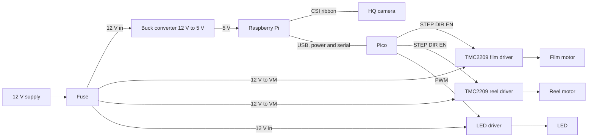
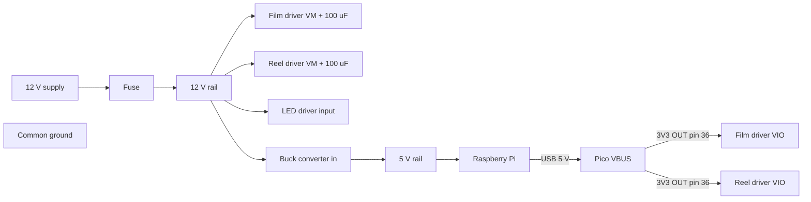
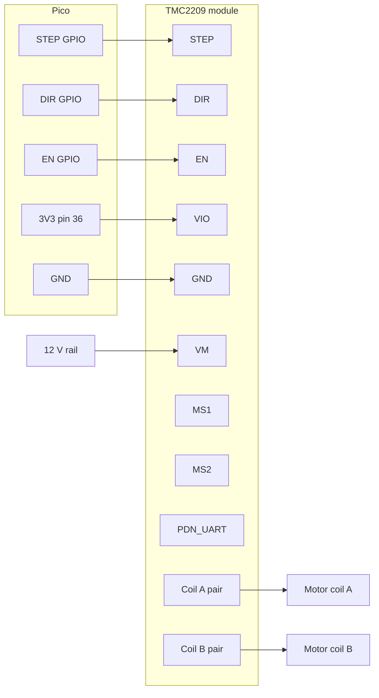
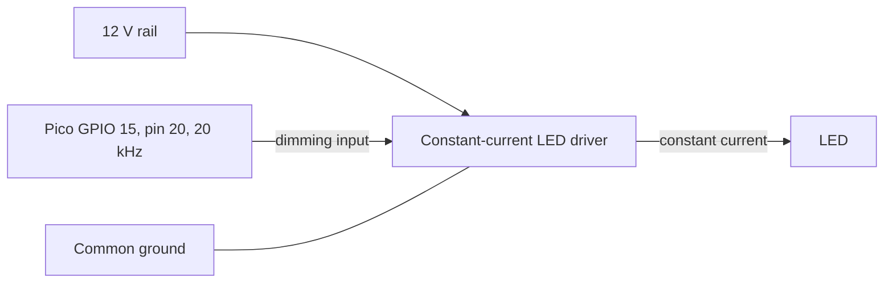

# Wiring schematics (perfboard build)

Text schematics for the first build on perfboard. A later PCB plan redraws the same connections in KiCad. Pico GPIO numbers come from `firmware/pins.py`, which is the single source of truth; if it changes, change this file.

**Datasheet status.** Pico facts were read from the [Raspberry Pi Pico datasheet](https://datasheets.raspberrypi.com/pico/pico-datasheet.pdf) (RP-008307-DS-2, Figure 2 pinout and section 2.1). The [TMC2209 datasheet](https://www.analog.com/media/en/technical-documentation/data-sheets/tmc2209_datasheet_rev1.09.pdf) could not be downloaded when this was written (analog.com timed out; see the [datasheet index](../datasheets/README.md)). Every TMC2209 fact below is therefore **unverified** and marked "VERIFY against your module's datasheet before powering". Read the TMC2209 datasheet (pin table, microstepping table, absolute maximum ratings) and your module seller's pinout before applying power, and correct this file.

## 1. Overview

## 2. Power

| Rail | From | To | Notes |
|---|---|---|---|
| 12 V | Supply, then fuse | Both TMC2209 VM pins, LED driver input, buck converter input | Fuse rating: size it above the normal total draw and below the wire rating (VERIFY with your supply and motor ratings). |
| 5 V | Buck converter | Raspberry Pi | Buck must supply at least the Pi's needs; the datasheet index notes the Pi 4 needs about 3 A. Check the Pi 4 datasheet. |
| 5 V (USB) | Pi USB port | Pico VBUS (micro-USB) | Pico datasheet section 2.1: VBUS is the micro-USB 5 V input. |
| 3V3 | Pico pin 36 (3V3(OUT)) | Both TMC2209 VIO pins | Pico datasheet: 3V3 can power external circuitry, keep the load under 300 mA. Two driver logic supplies are far below that, but check the TMC2209 VIO current (VERIFY). |
| Ground | One shared ground | Supply negative, both drivers' GND, LED driver, buck, Pico GND | Pi and Pico also share ground through USB. Use a Pico GND pin (3, 8, 13, 18, 23, 28, 33 or 38, Pico datasheet Figure 2). |

Put a 100 uF electrolytic capacitor across VM and GND at each TMC2209 module, close to the pins, with the stripe (negative) on GND. Its voltage rating must be above the 12 V rail with margin; take the figure from the TMC2209 datasheet's VM range (VERIFY). Many modules already carry one; check before adding another.

## 3. Pico pin table

Pin numbers: Pico datasheet Figure 2 (physical pin numbers, Rev3 board). GPIOs: `firmware/pins.py`.

| Signal | GPIO | Pico pin | Goes to | Direction | Notes |
|---|---|---|---|---|---|
| FILM_STEP | 2 | 4 | Film TMC2209 STEP | Pico to driver | One pulse per microstep |
| FILM_DIR | 3 | 5 | Film TMC2209 DIR | Pico to driver | Direction |
| FILM_EN | 4 | 6 | Film TMC2209 EN | Pico to driver | Active low; needs an external pull-up to VIO (see note below); firmware drives it high at start; film motor is held after a move |
| REEL_STEP | 5 | 7 | Reel TMC2209 STEP | Pico to driver | |
| REEL_DIR | 6 | 9 | Reel TMC2209 DIR | Pico to driver | |
| REEL_EN | 7 | 10 | Reel TMC2209 EN | Pico to driver | Active low; needs an external pull-up to VIO (see note below); reel motor is released after each move |
| SENSOR_IN | 14 | 19 | Optional sensor | Sensor to Pico | Reserved; the firmware does not read it |
| LED_PWM | 15 | 20 | LED driver dimming input | Pico to driver | 20 kHz PWM from `firmware/main.py` |
| 3V3(OUT) | | 36 | Driver VIO pins | Power out | See section 2 |
| GND | | 3, 8, 13, 18, 23, 28, 33, 38 | Common ground | | Pick the one nearest the signal pins (3 or 8) |

**Required: pull-up on each EN line.** Fit one pull-up resistor from FILM_EN (GPIO 4) to VIO and one from REEL_EN (GPIO 7) to VIO. Nothing holds EN high before `firmware/main.py` runs: the RP2040 datasheet lists every user GPIO (including GPIO 4 and 7) with reset state "Pull-Down" (pin list table, and the pad control register field PDE resets to 0x1), so EN reads low and both TMC2209 drivers are enabled at power-up, in BOOTSEL, on a blank Pico and after a crash. With STEP also low there is no motion, but the coils are energised (holding current, heat). Resistor value: VERIFY against your module's datasheet before powering (the module may already have its own EN pull-up or pull-down, and EN polarity and VIO level must be checked too).

Pico GPIO is 3.3 V logic.

## 4. TMC2209 module wiring (one diagram, used twice)

All names and functions in this table are **unverified** (datasheet not read). VERIFY against your module's datasheet before powering: pin order differs between vendors.

| Module pin | Function (VERIFY) | Film driver | Reel driver |
|---|---|---|---|
| VM | Motor supply | 12 V rail (+ 100 uF) | 12 V rail (+ 100 uF) |
| GND | Ground | Common ground | Common ground |
| VIO | Logic supply | Pico 3V3 (pin 36) | Pico 3V3 (pin 36) |
| EN | Enable, active low | GPIO 4 | GPIO 7 |
| STEP | Step input | GPIO 2 | GPIO 5 |
| DIR | Direction input | GPIO 3 | GPIO 6 |
| MS1, MS2 | Microstep select in standalone mode | See below | See below |
| PDN_UART | Single-wire UART / power-down pin | See below | See below |
| Four motor pins | Coil A and coil B outputs | Film motor | Reel motor |

- **EN is active low.** A pull-up from EN to VIO is required (see the note under the Pico pin table); without it the drivers are enabled until the firmware starts. The firmware drives EN high at start (outputs off) and low for a move (`firmware/main.py`). The film driver is left enabled after a move, so the film does not drift; the reel driver is disabled after each move.
- **Microstepping.** `reel_steps_per_rev = 3200` in `app/config.py` is 200 full steps times 16, so it assumes 1/16 microstepping. Which MS1/MS2 levels select 1/16 is in the TMC2209 datasheet microstepping table (not read). VERIFY against your module's datasheet before powering, and tie MS1 and MS2 to GND or VIO accordingly; many modules set these with jumpers or solder pads. If you use a different resolution, change `reel_steps_per_rev` and `steps_per_frame`.
- **PDN_UART.** In standalone STEP/DIR mode this pin has a required state. VERIFY against your module's datasheet before powering; some modules tie it for you, others leave it for you to wire. Do not leave it floating by guess.
- Do not rely on the silkscreen order of one module to wire another.

## 5. Stepper motors

Finding the two coil pairs of a NEMA 17 (bipolar, usually four wires):

1. With the motor unplugged, measure resistance between wire pairs. A pair that reads a low, finite resistance (a few ohms for typical motors; use your motor's datasheet) is one coil. The other pair is the second coil. Pairs that read open belong to different coils.
2. Alternatively, spin the shaft by hand and short two wires together: a coil pair makes the shaft noticeably harder to turn.
3. Connect coil A to the module's A pair and coil B to the B pair (VERIFY the module's output labels).

Swapping the two wires of one coil pair reverses the direction. Do not swap wires between pairs.

**Current setting.** Set the driver's reference voltage for the motor's rated current with the motor unplugged (step 3 of section 9; the module needs VM and VIO powered to be adjusted). The formula depends on the module's sense resistors and the TMC2209 configuration: use the formula in the TMC2209 datasheet and your module's documentation (VERIFY, not taken from a datasheet here).

## 6. LED lighting

| Connection | From | To | Notes |
|---|---|---|---|
| Power | 12 V rail | LED driver input | Check the driver's input voltage range |
| Dimming | Pico GPIO 15 (pin 20) | Driver PWM dimming input | 3.3 V logic. Check the driver's dimming-input high level and maximum PWM frequency: the firmware uses 20 kHz |
| Output | LED driver | LED | Observe polarity |
| Ground | Common ground | Driver GND | Shared with the Pico |

- Choose a driver whose output current matches the LED's rated current. Never exceed the LED's rating.
- Never drive the LED directly from a GPIO.
- Warning: if the dimming input needs more than 3.3 V to count as "high", the Pico cannot dim it directly. Check the driver datasheet before connecting GPIO 15.
- Warning: many constant-current drivers pull their DIM/PWM input up internally to a voltage above 3.3 V, which can push current into GPIO 15. Measure the dimming input's open-circuit voltage before connecting. If it is above 3.3 V, drive it through a transistor or open-collector stage; this inverts the PWM, so the firmware duty would need inverting.
- Warning: if the driver pulls DIM up internally, the LED runs at full brightness whenever the Pico is unpowered or not driving GPIO 15 (before the firmware starts, in BOOTSEL, after a crash). VERIFY the driver's behaviour with the dimming input unconnected.

## 7. Pi connections

- USB: Pi to the Pico's micro-USB. Carries power and serial (`/dev/ttyACM0`). The Pi and Pico share ground through this cable.
- CSI ribbon: Pi to the HQ camera. Keep it away from motor wiring.
- 5 V feed: buck converter output to the Pi. VERIFY the Pi's power input method and rating in its datasheet.

## 8. Connectors and wire

Recommendations only.

- Keyed (polarised) connectors for motors and power, so they cannot go in backwards.
- Wire gauge for 12 V runs and motor leads: choose from the fuse and motor current, using a standard wire ampacity table.
- Strain relief on every cable that leaves the board.
- A fuse on the 12 V input (section 2).
- Route motor wiring away from the camera ribbon and signal wires.

## 9. Safety and power-up order

Never connect or disconnect a motor while the 12 V is on. Hot-plugging a motor can destroy the driver. (General practice for stepper drivers; also check the TMC2209 datasheet, VERIFY.)

1. Power up with no motors, Pi or Pico connected. Measure the 12 V and 5 V rails with a multimeter and confirm both.
2. Power down. Connect the Pi and the Pico (USB), still with no motors connected.
3. Power up and set Vref on each driver with its motor unplugged (VM from the 12 V rail, VIO from the Pico 3V3). The adjustment method and measuring point depend on the module: VERIFY against your module's datasheet before powering.
4. Power down. Connect ONE motor, power up and test it. Repeat for the other motor.

## 10. Bring-up checks per wire group

1. Serial: Pi to Pico over USB. Send `STATUS` and expect a reply. Failure: cable (data, not charge-only) or firmware not flashed.
2. LED: `LIGHT 30` dims the LED to about 30 percent. Failure: dimming input level or polarity, driver supply.
3. Film motor: `ADVANCE 164` moves one frame. Failure with no motion: EN wiring, VM missing, Vref too low.
4. Reel motor: `WIND 100` moves. Same causes.
5. Direction: both motors should turn the film the way you expect. Wrong direction: swap one coil pair on that motor (power off first), or use `flip_vertical` only for the image, not for motor direction.
6. Stutter or lost steps: current too low, a loose or wrong coil pair, wrong microstepping setting.

## 11. Revision history

| Version | Date | Change |
|---|---|---|
| 1 | 2026-10-27 | First version. Pico pins checked against its datasheet; TMC2209 items not checked (datasheet unreachable). |
