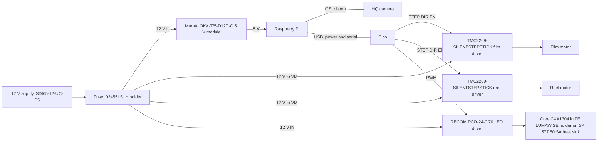
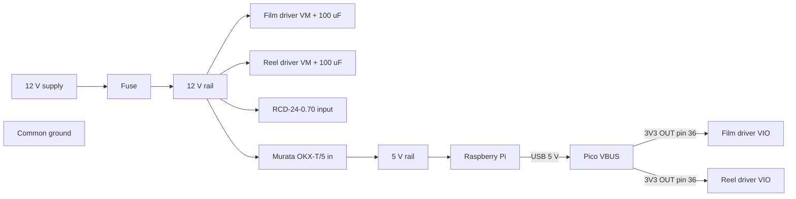
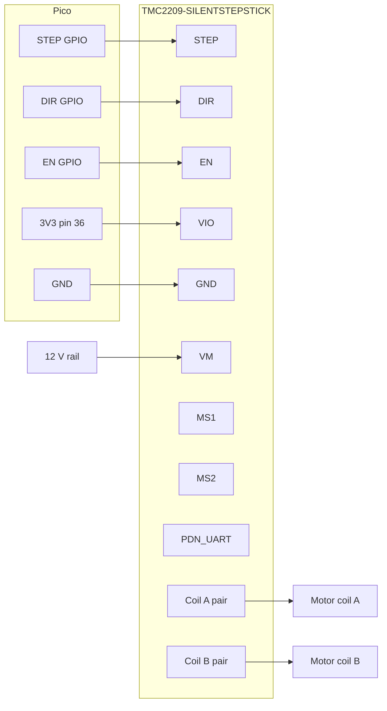
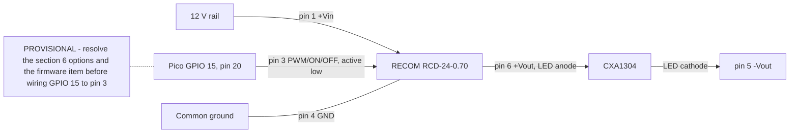

# Wiring schematics (perfboard build)

Text schematics for the first build on perfboard. A later PCB plan redraws the same connections in KiCad. Pico GPIO numbers come from `firmware/pins.py`, which is the single source of truth; if it changes, change this file.

**Datasheet status.** Pico facts were read from the [Raspberry Pi Pico datasheet](https://datasheets.raspberrypi.com/pico/pico-datasheet.pdf) (RP-008307-DS-2, Figure 2 pinout and section 2.1). The [TMC2209 datasheet](https://www.analog.com/media/en/technical-documentation/data-sheets/tmc2209_datasheet_rev1.09.pdf) could not be downloaded when this was written (analog.com timed out; see the [datasheet index](../datasheets/README.md)). The v3 parts ([bill of materials](bom.md)) were checked as follows. The RECOM RCD-24 datasheet (REV 1/2016, [PDF](https://recom-power.com/pdf/Lightline_DC-DC/RCD-24.pdf)) and the Cree XLamp CXA1304 datasheet (CLD-DS73 REV 11A) were downloaded and read; section 6 cites them. The TMC2209 datasheet was still unreachable when rechecked for Task 20, and the Murata OKX-T/5, TE LUMAWISE, Fischer, Littelfuse and TMC2209-SILENTSTEPSTICK documents were not reachable. Every TMC2209 and 5 V module fact below is therefore **unverified** and marked "VERIFY against your module's datasheet before powering". Read the TMC2209 datasheet (pin table, microstepping table, absolute maximum ratings) and your module seller's pinout before applying power, and correct this file.

## 1. Overview

## 2. Power

| Rail | From | To | Notes |
|---|---|---|---|
| 12 V | Bel/CUI SDI65-12-UC-P5 adapter (12 V 5 A, 5.5 x 2.1 mm barrel, centre-positive per the BOM; confirm polarity on the unit), then a fuse in a Littelfuse 03455LS1H 5 x 20 mm holder | Both TMC2209 VM pins, RCD-24 input, Murata module input | Fuse rating: BOM suggests a 6.3 A 5 x 20 mm fuse against the 5 A supply; size it above the normal total draw and below the wire rating (VERIFY with your supply and motor ratings; the holder's rating was not read). |
| 5 V | Murata OKX-T/5-D12P-C (non-isolated 5 A step-down, 8.3-13.8 V in, output adjustable 0.7525-5.5 V per the BOM listing) | Raspberry Pi | The output is set to 5 V by a trim resistor (**VERIFY the topology too: which pin, and whether to ground or to another pin; it is not from any datasheet I read**). **VERIFY the resistor value and the pinout in the Murata datasheet (not reachable: its site answered curl with a bot-protection page); do not guess it.** Measure the output with nothing connected (step 1 of section 9) before connecting the Pi. The 13.8 V input limit leaves little margin over a 12 V adapter: VERIFY. Lead time shown is long (38 weeks); budget alternative in the BOM. The Pi 4 needs about 3 A (datasheet index). |
| 5 V (USB) | Pi USB port | Pico VBUS (micro-USB) | Pico datasheet section 2.1: VBUS is the micro-USB 5 V input. |
| 3V3 | Pico pin 36 (3V3(OUT)) | Both TMC2209 VIO pins | Pico datasheet: 3V3 can power external circuitry, keep the load under 300 mA. Two driver logic supplies are far below that, but check the TMC2209 VIO current (VERIFY). |
| Ground | One shared ground | Supply negative, both drivers' GND, RCD-24 pin 4 (GND), Murata module ground, Pico GND | Pi and Pico also share ground through USB. Use a Pico GND pin (3, 8, 13, 18, 23, 28, 33 or 38, Pico datasheet Figure 2). |

Put a 100 uF electrolytic capacitor across VM and GND at each TMC2209 module, close to the pins, with the stripe (negative) on GND. The Rubycon 35YXJ100M capacitor from the BOM is rated 35 V, 100 uF, 105 C (Rubycon YXJ datasheet, specifications table and 35 V rows). That is above the 12 V rail; the TMC2209 datasheet's VM range is still VERIFY. Many modules already carry one; check before adding another.

## 3. Pico pin table

Pin numbers: Pico datasheet Figure 2 (physical pin numbers, Rev3 board). GPIOs: `firmware/pins.py`.

| Signal | GPIO | Pico pin | Goes to | Direction | Notes |
|---|---|---|---|---|---|
| FILM_STEP | 2 | 4 | Film TMC2209 STEP | Pico to driver | One pulse per microstep |
| FILM_DIR | 3 | 5 | Film TMC2209 DIR | Pico to driver | Direction |
| FILM_EN | 4 | 6 | Film TMC2209 EN | Pico to driver | Active low; needs an external pull-up to VIO (see note below); firmware drives it high at start; film motor is held after a move |
| REEL_STEP | 5 | 7 | Reel TMC2209 STEP | Pico to driver | |
| REEL_DIR | 6 | 9 | Reel TMC2209 DIR | Pico to driver | |
| REEL_EN | 7 | 10 | Reel TMC2209 EN | Pico to driver | Active low; needs an external pull-up to VIO (see note below); reel motor is released after each move |
| SENSOR_IN | 14 | 19 | Optional sensor | Sensor to Pico | Reserved; the firmware does not read it |
| LED_PWM | 15 | 20 | LED driver dimming input | Pico to driver | 20 kHz PWM from `firmware/main.py` (outside the RCD-24's range, see section 6) |
| 3V3(OUT) | | 36 | Driver VIO pins | Power out | See section 2 |
| GND | | 3, 8, 13, 18, 23, 28, 33, 38 | Common ground | | Pick the one nearest the signal pins (3 or 8) |

**Required: pull-up on each EN line.** Fit one pull-up resistor from FILM_EN (GPIO 4) to VIO and one from REEL_EN (GPIO 7) to VIO. Nothing holds EN high before `firmware/main.py` runs: the RP2040 datasheet lists every user GPIO (including GPIO 4 and 7) with reset state "Pull-Down" (pin list table, and the pad control register field PDE resets to 0x1), so EN reads low and both TMC2209 drivers are enabled at power-up, in BOOTSEL, on a blank Pico and after a crash. With STEP also low there is no motion, but the coils are energised (holding current, heat). Resistor value: VERIFY against your module's datasheet before powering (the module may already have its own EN pull-up or pull-down, and EN polarity and VIO level must be checked too).

Pico GPIO is 3.3 V logic.

## 4. TMC2209-SILENTSTEPSTICK module wiring (one diagram, used twice)

The BOM selects the official Analog Devices / Trinamic TMC2209-SILENTSTEPSTICK module for both drivers. Its datasheet and user guide were not reachable, so everything below stays VERIFY.

All names and functions in this table are **unverified** (datasheet not read). VERIFY against your module's datasheet before powering: pin order differs between vendors.

| Module pin | Function (VERIFY) | Film driver | Reel driver |
|---|---|---|---|
| VM | Motor supply | 12 V rail (+ 100 uF) | 12 V rail (+ 100 uF) |
| GND | Ground | Common ground | Common ground |
| VIO | Logic supply | Pico 3V3 (pin 36) | Pico 3V3 (pin 36) |
| EN | Enable, active low | GPIO 4 | GPIO 7 |
| STEP | Step input | GPIO 2 | GPIO 5 |
| DIR | Direction input | GPIO 3 | GPIO 6 |
| MS1, MS2 | Microstep select in standalone mode | See below | See below |
| PDN_UART | Single-wire UART / power-down pin | See below | See below |
| Four motor pins | Coil A and coil B outputs | Film motor | Reel motor |

- **EN is active low.** A pull-up from EN to VIO is required (see the note under the Pico pin table); without it the drivers are enabled until the firmware starts. The firmware drives EN high at start (outputs off) and low for a move (`firmware/main.py`). The film driver is left enabled after a move, so the film does not drift; the reel driver is disabled after each move.
- **Microstepping.** `reel_steps_per_rev = 3200` in `app/config.py` is 200 full steps times 16, so it assumes 1/16 microstepping. Which MS1/MS2 levels select 1/16 is in the TMC2209 datasheet microstepping table (not read). VERIFY against your module's datasheet before powering, and tie MS1 and MS2 to GND or VIO accordingly; many modules set these with jumpers or solder pads. If you use a different resolution, change `reel_steps_per_rev` and `steps_per_frame`.
- **PDN_UART.** In standalone STEP/DIR mode this pin has a required state. VERIFY against your module's datasheet before powering; some modules tie it for you, others leave it for you to wire. Do not leave it floating by guess.
- Do not rely on the silkscreen order of one module to wire another.

## 5. Stepper motors

Finding the two coil pairs of a NEMA 17 (bipolar, usually four wires):

1. With the motor unplugged, measure resistance between wire pairs. A pair that reads a low, finite resistance (a few ohms for typical motors; use your motor's datasheet) is one coil. The other pair is the second coil. Pairs that read open belong to different coils.
2. Alternatively, spin the shaft by hand and short two wires together: a coil pair makes the shaft noticeably harder to turn.
3. Connect coil A to the module's A pair and coil B to the B pair (VERIFY the module's output labels).

Swapping the two wires of one coil pair reverses the direction. Do not swap wires between pairs.

**Current setting.** Set the driver's reference voltage for the motor's rated current with the motor unplugged (step 3 of section 9; the module needs VM and VIO powered to be adjusted). The formula depends on the module's sense resistors and the TMC2209 configuration: use the formula in the TMC2209 datasheet and your module's documentation (VERIFY, not taken from a datasheet here).

## 6. LED lighting

Parts (BOM v3): Cree XLamp CXA1304, order code CXA1304-0000-000C0UA450H (9 V class, 5000 K, CRI 90 minimum), in a TE LUMAWISE solderless holder (part number unconfirmed) on a Fischer SK 577 50 SA heat sink, driven by a RECOM RCD-24-0.70 (700 mA) from the 12 V rail. Do not use the 18 V class code CXA1304-0000-000F0HB40E3 that appears in some listings.

**PROVISIONAL.** The direct GPIO 15 to pin 3 connection in the diagram and the table below is not a settled design: resolve the options (a), (b), (c) under finding 2 and the firmware item in the [roadmap](../ROADMAP.md) before wiring it.

Pinned RCD-24 (RECOM datasheet, "Package Style and Pinning", pinned version):

| Pin | Function | Connection | Notes |
|---|---|---|---|
| 1 | +Vin | 12 V rail | Input 4.5-36 V for the 0.70 version; recommended 5 V min, 24 V typ, 36 V max (specifications table) |
| 2 | Analogue dimming | Leave open | "Leave open if not used" (page L-7) |
| 3 | PWM/ON/OFF | GPIO 15 (pin 20) | See the polarity and frequency findings below |
| 4 | GND | Common ground | The datasheet says "Do not connect to -Vout" |
| 5 | -Vout | LED cathode | **Not ground.** Do not join it to pin 4 or to the common ground |
| 6 | +Vout | LED anode | Observe polarity |

Datasheet values (RCD-24 REV 1/2016, specifications tables and "Typical Characteristics" page): output 0-700 mA, output voltage 2-35 V, current accuracy 1 percent typical and 3 percent maximum (300-700 mA versions), maximum capacitive load 100 uF. LED side (CXA1304 datasheet page 2 and 17): 9 V class forward voltage 9 V typical at 400 mA and 85 C and 10.5 V maximum at 400 mA and 25 C, about 9.9 V at 700 mA and 25 C from the graph; maximum DC forward current 1000 mA (derated above 85 C case temperature, page 3). So 700 mA is within the LED's rating and the 12 V rail leaves about 2 V above the LED voltage typical at 25 C; the maximum LED forward voltage at 700 mA is not given (10.5 V max is given only at 400 mA), so the worst case may be under 1 V of headroom: confirm with a measurement. The "Dropout Voltage/Load" graph shows roughly 0.5 V or less for the 500/700 mA curve (approximate, read from the graph at Vin 36 V); the datasheet gives no headroom table, so the exact minimum input-to-output voltage is not stated: measure it with the real adapter (a sagging 12 V rail near 10.5 V LED voltage could drop the current).

**Findings that affect the firmware (not fixed here).**

1. **The PWM pin is active low.** Datasheet, "PWM Dimming and ON/OFF Control": the converter is ON when the pin is open or 0 V < Vr < 0.6 V, OFF (standby) at 0.6-2.9 V and OFF (shutdown) at 2.9-6 V (300-700 mA versions). A high GPIO 15 turns the LED off, so the firmware's duty would need inverting (duty = 100 minus brightness) or the signal inverted in hardware. The datasheet's digital dimming figure shows the same. Pico 3.3 V is inside the 2.9-6 V shutdown range, but with only about 0.4 V of margin: measure it.
2. **The datasheet limits PWM to 200 Hz for linear operation and 1000 Hz as the frequency limit** (same table, "Maximum PWM Frequency"). The firmware drives GPIO 15 at **20 kHz, outside the RCD-24's stated PWM range**. Brightness at 20 kHz is not specified and may not follow the duty. Choices, none implemented here (a separate firmware task is on the [roadmap](../ROADMAP.md)): (a) change the firmware to a PWM frequency of at most 1000 Hz with inverted duty; keep in mind that PWM at or below 1 kHz can band against short camera exposures, so exposure times should be several PWM periods (VERIFY on the bench); (b) use the analogue dimming pin (pin 2) instead: the datasheet's application "LED dimmer with high frequency PWM control" feeds a 10 kHz TTL PWM through an R-C filter into that pin (R and C values are not given); the analogue input is full on at 0.13 V plus or minus 50 mV and full off at 4.2 V plus or minus 150 mV, so a filtered 3.3 V signal will not reach full off (derived from those figures); (c) run the LED at a fixed current and set brightness with camera exposure instead. Whether the datasheet revision is current is also unchecked.
3. **Open pin means full brightness.** Resolves the earlier VERIFY about the unconnected dimming input: with pin 3 open the driver is ON (see 1), i.e. 700 mA. Before the firmware runs, the RP2040 GPIO is pulled down (see the EN note in section 3), which also reads as ON. So the LED is at full brightness at power-up, in BOOTSEL and after a crash, unless an external pull-up from pin 3 holds it off. The pull-up source must be above 2.9 V (the shutdown threshold) and, because GPIO 15 sits on the same node and is not 5 V tolerant, **at most 3.3 V** while GPIO 15 is connected directly; a higher source needs an open-collector or transistor stage instead. The section heading of the datasheet's specifications table (page L-4, "PWM Dimming and ON/OFF Control") reads "Leave open if not used - do not tie to +Vin", and the pinning table (page L-7) says "Leave open if not used". 6 V is the top of the specified control range (shutdown 2.9-6 V), not an absolute maximum for pin 3; I found no absolute-maximum figure for this pin in the pages read (the -0.3 to 15 V figure, "Input Voltage Limits" on page L-4, is for the analogue pin), so VERIFY it. This document's own advice: never connect pin 3 to the 12 V rail. The pin's drive current is 1 mA maximum at 5 V, which is the load to size such a pull-up against. A pull-up to Pico 3V3 does nothing while the Pico is unpowered. The pull-up source must be the Pico's own 3V3 (pin 36), not another 3.3 V rail: a pull-up from a different supply would back-feed GPIO 15 while the Pico is unpowered. Value: VERIFY.
4. **Never connect or disconnect the LED while the driver is powered** (RECOM datasheet, final page warning: it may damage the LED or reduce its life).

| Connection | From | To | Notes |
|---|---|---|---|
| Power | 12 V rail | RCD-24 pin 1 | Input range checked above |
| Dimming | Pico GPIO 15 (pin 20) | RCD-24 pin 3 | **PROVISIONAL: resolve the section 6 options (a/b/c) and the firmware item before wiring this.** 3.3 V logic; active low; 20 kHz is outside the stated range (above); 3.3 V against the 2.9 V shutdown threshold leaves only 0.4 V of margin (measure it) |
| Output | RCD-24 pins 6 and 5 | CXA1304 anode and cathode | Observe polarity; cathode is not ground |
| Ground | Common ground | RCD-24 pin 4 | Shared with the Pico |

- The RCD-24 is a current source for 700 mA: never exceed the LED's rating, and never drive the LED directly from a GPIO.
- LED mounting: the CXA1304 sits in the TE LUMAWISE holder (solderless; TE part number and footprint VERIFY in TE's datasheet, not reachable) on the Fischer SK 577 50 SA heat sink (mounting method VERIFY; the BOM notes it is oversized). Cree recommends a maximum light-emitting-surface temperature of 135 C (datasheet page 3).
- Warning: the datasheet does not state pin 3's open-circuit voltage. Measure it before connecting GPIO 15; if it is above 3.3 V, drive the pin through a transistor stage (which also inverts the signal) instead of directly.

## 7. Pi connections

- USB: Pi to the Pico's micro-USB. Carries power and serial (`/dev/ttyACM0`). The Pi and Pico share ground through this cable.
- CSI ribbon: Pi to the HQ camera. Keep it away from motor wiring.
- 5 V feed: Murata OKX-T/5-D12P-C output (set to 5 V by its trim resistor) to the Pi. VERIFY the Pi's power input method and rating in its datasheet.

## 8. Connectors and wire

Recommendations only.

- Keyed (polarised) connectors for motors and power, so they cannot go in backwards.
- Wire gauge for 12 V runs and motor leads: choose from the fuse and motor current, using a standard wire ampacity table.
- Strain relief on every cable that leaves the board.
- A fuse on the 12 V input (section 2).
- Route motor wiring away from the camera ribbon and signal wires.

## 9. Safety and power-up order

Never connect or disconnect a motor while the 12 V is on. Hot-plugging a motor can destroy the driver. (General practice for stepper drivers; also check the TMC2209 datasheet, VERIFY.)

1. Power up with no motors, Pi, Pico or LED driver connected (the RCD-24 and LED stay off the rail until step 5). Measure the 12 V rail and the Murata module's 5 V output with a multimeter and confirm both; if the 5 V output is wrong, adjust the trim resistor before anything is connected.
2. Power down. Connect the Pi and the Pico (USB), still with no motors connected.
3. Power up and set Vref on each driver with its motor unplugged (VM from the 12 V rail, VIO from the Pico 3V3). The adjustment method and measuring point depend on the module: VERIFY against your module's datasheet before powering.
4. Power down. Connect ONE motor, power up and test it. Repeat for the other motor.
5. Power down. Connect the RCD-24 and the LED (LED wired to pins 6 and 5 before power; never plug or unplug it with power on). Power up. With the current firmware (`firmware/main.py` sets duty 0 at start and exit, and `LIGHT n` writes duty n percent) and the RCD-24's active-low dimming pin, duty 0 holds the pin low, which is **full on**: the LED is fully lit from boot, after the loop exits and whenever the firmware is not running, and `LIGHT 0` does **not** darken it. Higher `LIGHT` values dim only if PWM at 20 kHz works at all (not specified, section 6 finding 2). Until the firmware item on the [roadmap](../ROADMAP.md) lands, the safe way to keep the LED dark is to leave the RCD-24 disconnected or unpowered; do not rely on `LIGHT 0`.

## 10. Bring-up checks per wire group

1. Serial: Pi to Pico over USB. Send `STATUS` and expect a reply. Failure: cable (data, not charge-only) or firmware not flashed.
2. LED: `LIGHT 30` dims the LED to about 30 percent once the firmware item is fixed; with the current firmware the polarity is inverted (see section 9 step 5). Failure: dimming input level, **inverted polarity or the 20 kHz frequency (section 6)**, driver supply.
3. Film motor: `ADVANCE 164` moves one frame. Failure with no motion: EN wiring, VM missing, Vref too low.
4. Reel motor: `WIND 100` moves. Same causes.
5. Direction: both motors should turn the film the way you expect. Wrong direction: swap one coil pair on that motor (power off first), or use `flip_vertical` only for the image, not for motor direction.
6. Stutter or lost steps: current too low, a loose or wrong coil pair, wrong microstepping setting.

## 11. Revision history

| Version | Date | Change |
|---|---|---|
| 1 | 2026-10-27 | First version. Pico pins checked against its datasheet; TMC2209 items not checked (datasheet unreachable). |
| 2 | 2026-10-27 | Adopted the v3 BOM parts. Section 6 rewritten from the RECOM RCD-24 and Cree CXA1304 datasheets (pinout, active-low PWM pin, 200 Hz / 1 kHz PWM limit versus the firmware's 20 kHz, open pin = on). Power section names the Murata 5 V module, fuse holder and Rubycon capacitors. TMC2209 and Murata items still VERIFY (documents unreachable). |
