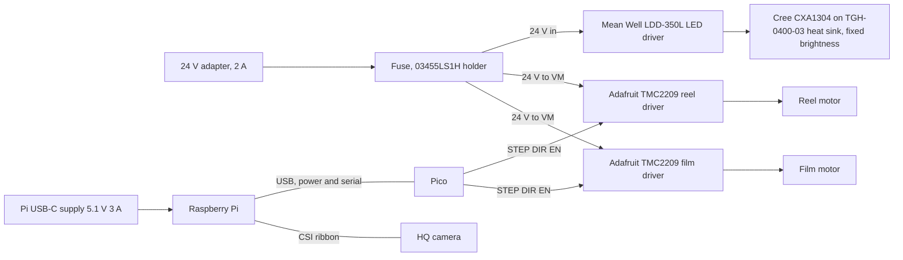
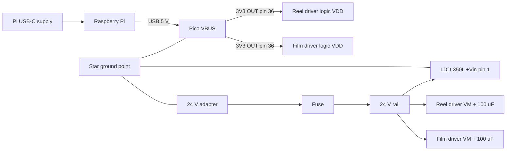
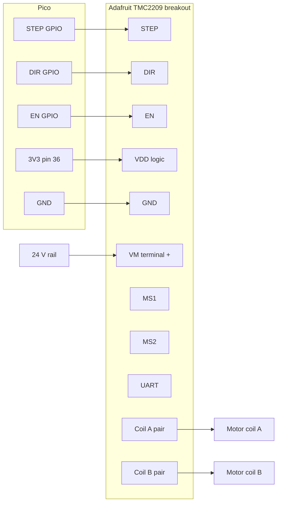
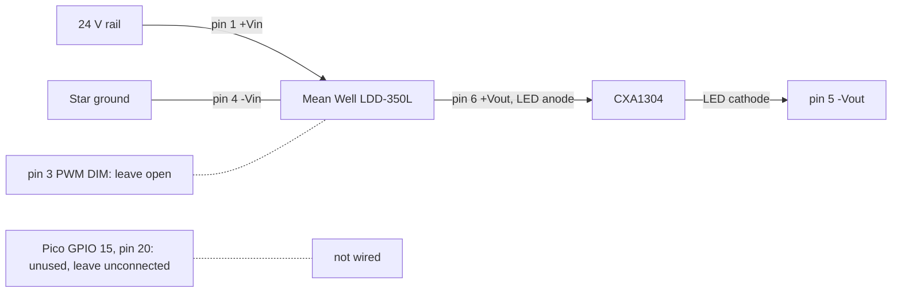

# Wiring schematics (perfboard build)

Text schematics for the first build on perfboard. A later PCB plan redraws the same connections in KiCad. Pico GPIO numbers come from `firmware/pins.py`, which is the single source of truth; if it changes, change this file.

**Datasheet status (v4 build).** Pico facts were read from the [Raspberry Pi Pico datasheet](https://datasheets.raspberrypi.com/pico/pico-datasheet.pdf) (RP-008307-DS-2, Figure 2 pinout and section 2.1). The Mean Well LDD-L datasheet ("LDD-L-SPEC", file dated 2026-09-15, [PDF](https://www.meanwell.com/Upload/PDF/LDD-L/LDD-L-SPEC.PDF)) and the Cree XLamp CXA1304 datasheet (CLD-DS73 REV 11A) were downloaded and read on 2026-10-27; section 6 cites them by page. The default driver modules are the Adafruit TMC2209 breakout (product 6121); the Adafruit product page and its pinouts guide were read (module-level facts, cited where used), but the [TMC2209 chip datasheet](https://www.analog.com/media/en/technical-documentation/data-sheets/tmc2209_datasheet_rev1.09.pdf) could not be downloaded (analog.com connection failure, see the [datasheet index](../datasheets/README.md)). Every TMC2209 chip-level fact below (VM limit, EN/PDN behaviour, microstep table, current formula) is therefore **unverified** and marked VERIFY. The T-Global TGH-0400-03 thermal resistance and the Littelfuse holder document were not readable, so the heat-sink margin in section 6 is a bring-up measurement, not a calculation. Read the TMC2209 datasheet before applying power and correct this file.

## 1. Overview

The LED driver's dimming input and Pico GPIO 15 are not connected (section 6). There is no 5 V step-down module: the Pi has its own USB-C supply.

## 2. Power

| Rail | From | To | Notes |
|---|---|---|---|
| 24 V | Generic UL-listed 24 V 2 A adapter, 5.5 x 2.1 mm barrel, centre-positive (confirm polarity on the unit), through a panel jack and then a fuse in a Littelfuse 03455LS1H 5 x 20 mm holder | Both TMC2209 VM pins and the LDD-350L +Vin (pin 1) | Fuse: about 2.5-3.15 A slow-blow for a 2 A adapter (VERIFY against the adapter's rating and the wire; the holder's rating was not read). Measure the rail with nothing connected (section 9 step 1). Mean Well LDD-L input range is 9-36 V (datasheet page 1); Adafruit lists 5-29 V motor voltage for its board (product page); the TMC2209 chip figure is VERIFY (a DigiKey reference design listing said 4.75-28 V). 24 V leaves only about 4 V under that chip figure, so do not use an adapter above 24 V nominal and check its no-load voltage. |
| 5 V | The Pi's own USB-C supply (5.1 V 3 A, 15 W class) | Raspberry Pi | No step-down module. The Pi 4 needs about 3 A (datasheet index). |
| 5 V (USB) | Pi USB port | Pico VBUS (micro-USB) | Pico datasheet section 2.1: VBUS is the micro-USB 5 V input. |
| 3V3 | Pico pin 36 (3V3(OUT)) | Both TMC2209 logic supply pins (VDD on the Adafruit board; Adafruit lists 3-5 V logic) | Pico datasheet: 3V3 can power external circuitry, keep the load under 300 mA. Two driver logic supplies are far below that, but check the TMC2209 logic current (VERIFY). |
| Ground | One star point (below) | 24 V supply negative, both drivers' GND, LDD-350L -Vin (pin 4), Pico GND | Use a Pico GND pin (3, 8, 13, 18, 23, 28, 33 or 38, Pico datasheet Figure 2). |

**Star ground.** Make the 24 V negative, both driver GNDs, the LDD-350L -Vin (pin 4) and one Pico GND wire meet at one point (for example the negative side of the motor-supply terminal block), with the motor currents returning on short thick wires and the Pico wire taking no motor current. The Pico's ground reaches the Pi through the USB cable, and the Pi's supply is separate. Why: the STEP/DIR/EN signals are referenced to the Pico GND, and the drivers must see the same reference as their VM supply, otherwise logic levels shift by the motor current's voltage drop. **Plug-in order:** with the two supplies, ground is joined only through the USB cable and the star point. Plug the Pi supply and the USB cable first (Pico and the 3V3 logic up), then the 24 V; unplug in the reverse order. If the 24 V goes on while the Pico is off or unplugged, the driver logic supply is off while VM is on, and what the TMC2209 does in that state is not known here (VERIFY in its datasheet); the EN pull-ups go to that same logic supply, so they hold nothing while it is off. Never connect the LED driver's -Vout (pin 5) to this ground (section 6).

Put a 100 uF electrolytic capacitor across VM and GND at each TMC2209 module only if the module has none close to the pins: the Adafruit board carries a 22 uF 35 V capacitor on motor power already (Adafruit product page), and an added 100 uF is a reasonable bulk addition (VERIFY need). Rubycon 35YXJ100M is rated 35 V, 100 uF, 105 C (Rubycon YXJ datasheet, 35 V rows): on a 24 V rail that is a modest margin (24 x 1.5 = 36 V would exceed it, and a motor supply can spike); a 50 V part is the more conservative choice (stock for a 50 V part was not searched). Stripe (negative) on GND.

## 3. Pico pin table

Pin numbers: Pico datasheet Figure 2 (physical pin numbers, Rev3 board). GPIOs: `firmware/pins.py`.

| Signal | GPIO | Pico pin | Goes to | Direction | Notes |
|---|---|---|---|---|---|
| FILM_STEP | 2 | 4 | Film TMC2209 STEP | Pico to driver | One pulse per microstep |
| FILM_DIR | 3 | 5 | Film TMC2209 DIR | Pico to driver | Direction |
| FILM_EN | 4 | 6 | Film TMC2209 EN | Pico to driver | Active low; needs an external pull-up to VIO (see note below); firmware drives it high at start; film motor is held after a move |
| REEL_STEP | 5 | 7 | Reel TMC2209 STEP | Pico to driver | |
| REEL_DIR | 6 | 9 | Reel TMC2209 DIR | Pico to driver | |
| REEL_EN | 7 | 10 | Reel TMC2209 EN | Pico to driver | Active low; needs an external pull-up to VIO (see note below); reel motor is released after each move |
| SENSOR_IN | 14 | 19 | Optional sensor | Sensor to Pico | Reserved; the firmware does not read it |
| LED_PWM | 15 | 20 | Unused and reserved: leave unconnected (the LDD-350L dimming pin is also left open) | None | `firmware/main.py` still sets a 20 kHz PWM on it; with nothing wired it has no effect (section 6) |
| 3V3(OUT) | | 36 | Driver logic supply pins (VIO / VDD) | Power out | See section 2 |
| GND | | 3, 8, 13, 18, 23, 28, 33, 38 | Common ground | | Pick the one nearest the signal pins (3 or 8) |

**Required: pull-up on each EN line.** Fit one pull-up resistor from FILM_EN (GPIO 4) to VIO and one from REEL_EN (GPIO 7) to VIO. Nothing holds EN high before `firmware/main.py` runs: the RP2040 datasheet lists every user GPIO (including GPIO 4 and 7) with reset state "Pull-Down" (pin list table, and the pad control register field PDE resets to 0x1), so EN reads low and both TMC2209 drivers are enabled at power-up, in BOOTSEL, on a blank Pico and after a crash. With STEP also low there is no motion, but the coils are energised (holding current, heat). Resistor value: VERIFY against your module's datasheet before powering (the module may already have its own EN pull-up or pull-down, and EN polarity and VIO level must be checked too).

Pico GPIO is 3.3 V logic.

## 4. TMC2209 module wiring (Adafruit breakout, one diagram, used twice)

The BOM v4 default is the Adafruit TMC2209 breakout (Adafruit product 6121) for both drivers. The Adafruit product page and pinouts guide were read; the TMC2209 chip datasheet was not, so chip-level items stay VERIFY. The official TMC2209-SILENTSTEPSTICK and third-party StepStick modules are alternatives with different pin names and order: do not rely on this table for them.

Pin names are from the Adafruit pinouts guide (VDD, +, GND, 1A/1B, 2A/2B, DIR, STEP, EN, MS1, MS2, DIAG, INDEX, UART); the functions below are the guide's wording where cited and otherwise **unverified** (TMC2209 chip datasheet not read). VERIFY before powering: pin order differs between vendors.

| Module pin | Function (VERIFY) | Film driver | Reel driver |
|---|---|---|---|
| VM (the + terminal) | Motor supply, 5-29 V per Adafruit (chip limit VERIFY) | 24 V rail (+ 100 uF) | 24 V rail (+ 100 uF) |
| GND | Ground | Common ground | Common ground |
| VDD (VIO in this document's pull-up notes) | Logic supply, 3-5 V per Adafruit | Pico 3V3 (pin 36) | Pico 3V3 (pin 36) |
| EN | Enable, active low | GPIO 4 | GPIO 7 |
| STEP | Step input | GPIO 2 | GPIO 5 |
| DIR | Direction input | GPIO 3 | GPIO 6 |
| MS1, MS2 | Microstep select in standalone mode | See below | See below |
| UART (PDN_UART on the chip) | Single-wire UART; Adafruit's guide says it is not needed for basic control | See below | See below |
| 1A, 1B, 2A, 2B (terminal block) | Coil 1 and coil 2 outputs (Adafruit guide: bridge 1 and bridge 2) | Film motor | Reel motor |

- **EN is active low.** Adafruit's guide says pulling EN high disables the outputs; it does not say whether the board already pulls EN up or down (VERIFY). Keep the external pull-up from EN to VDD (10 k suggested, value VERIFY; see the note under the Pico pin table): without it the drivers are enabled until the firmware starts. The firmware drives EN high at start (outputs off) and low for a move (`firmware/main.py`). The film driver is left enabled after a move, so the film does not drift; the reel driver is disabled after each move.
- **Microstepping.** `reel_steps_per_rev = 3200` in `app/config.py` is 200 full steps times 16, so it assumes 1/16 microstepping. Adafruit's pinouts guide: the board defaults to 1/8 with MS1 and MS2 open or low, and tying **both MS1 and MS2 high gives 1/16**. So tie MS1 and MS2 to VDD (Pico 3V3 side) on both modules. That is the module guide's statement, not the TMC2209 chip's microstepping table (not read): VERIFY. If you use a different resolution, change `reel_steps_per_rev` and `steps_per_frame`.
- **UART pin (PDN_UART).** In standalone STEP/DIR mode this pin has a required state. VERIFY against your module's datasheet before powering; some modules tie it for you, others leave it for you to wire. Do not leave it floating by guess.
- Do not rely on the silkscreen order of one module to wire another.

## 5. Stepper motors

Finding the two coil pairs of a NEMA 17 (bipolar, usually four wires):

1. With the motor unplugged, measure resistance between wire pairs. A pair that reads a low, finite resistance (a few ohms for typical motors; use your motor's datasheet) is one coil. The other pair is the second coil. Pairs that read open belong to different coils.
2. Alternatively, spin the shaft by hand and short two wires together: a coil pair makes the shaft noticeably harder to turn.
3. Connect coil A to the module's A pair and coil B to the B pair (VERIFY the module's output labels).

Swapping the two wires of one coil pair reverses the direction. Do not swap wires between pairs.

**Current setting.** Set the driver's current for the motor's rated current with the motor unplugged (step 3 of section 9; the module needs VM and its logic supply powered to be adjusted). On the Adafruit board the current is set by an onboard potentiometer, fully right gives up to 2 A (Adafruit product page and pinouts guide); the measuring point and the relation between pot position and current are not given there and the chip formula is not read: VERIFY (TMC2209 datasheet and the Adafruit guide). The motor rating (1 A per the BOM) is what to aim for.

## 6. LED lighting (fixed brightness)

Parts (BOM v4): Cree XLamp CXA1304, order code CXA1304-0000-000C0UA450H (9 V class, 90 CRI minimum, 5000 K per the code, confirm), soldered or clamped onto a T-Global TGH-0400-03 pin-fin heat sink (40 x 40 mm, 11 mm fins), driven by a Mean Well **LDD-350L** constant-current driver (350 mA) from the 24 V rail. The brightness is fixed: it is set by exposure, not by the LED. Do not use the 18 V class code CXA1304-0000-000F0HB40E3 that appears in some listings.

**Why 24 V, not 12 V.** Mean Well LDD-L-SPEC (2026-09-15), page 1, note 4: "Output voltage will always step down by 3 volts from input DC voltage". The Cree 9 V part needs about 9.0-9.25 V at 350 mA and about 9.9 V at 700 mA (CLD-DS73 REV 11A page 17 graph, read approximately, Tc 85 C to 25 C), more than the 9 V a 12 V input can give. At 24 V the driver has 24 - 3 = 21 V available, so headroom is large.

Pinning of the LDD-L pin style, LDD-350L (Mean Well LDD-L-SPEC, "Pin Configuration", page 3; the wired LDD-350LW uses red, white, black, blue, yellow for pins 1, 3, 4, 5, 6; there is no pin 2):

| Pin | Function | Connection | Notes |
|---|---|---|---|
| 1 | +Vin | 24 V rail (after the fuse) | Input 9-36 V (page 1) |
| 3 | PWM DIM (ON/OFF and PWM dimming) | **Not connected** | Datasheet: "Leave open if not used"; open circuit = power ON, so the driver runs at its full 350 mA. Do not tie it to +Vin or to anything. |
| 4 | -Vin | Star ground | The datasheet says "Don't connect to -Vout" |
| 5 | -Vout | LED cathode | **Not ground.** Do not join it to pin 4 or the star ground |
| 6 | +Vout | LED anode | Observe polarity |

Datasheet values (LDD-L-SPEC page 1): 350 mA constant current, current accuracy plus or minus 5 percent typical at 24 V input, output 2-32 V, efficiency up to 95 percent at full load (24 V and 36 V input), ripple 150 mVp-p maximum, external capacitive load 2.2 uF maximum, operating case temperature 100 C maximum, over-temperature shutdown with automatic recovery (Tj 150 C typical), short-circuit protection. Working temperature up to 85 C ambient at full load for the 300-500 mA members (derating curve, page 2 or 3 of the PDF). Size 22.6 x 9.9 x 8.9 mm. Note 5: never connect the output to the input of the same unit or to another source. The LED side: CXA1304 9 V class, DC forward current maximum 1000 mA (page 2), so 350 mA is well within the rating.

**LED pads and mounting (CXA1304 page 27, mechanical drawing).** 13.35 mm square (plus or minus 0.2), 1.15 mm thick, 6.0 mm light-emitting surface. Two solder pads at opposite corners: the top-left pad is marked "+" (anode); the other pad (bottom-right in that view) is the cathode by elimination (not labelled in the drawing). The Tc (case temperature) measurement point is the round dot on the top face near the + pad. The v4 build has no holder: solder wires to the pads as the Cree soldering and handling document allows (not read here; VERIFY the method and the maximum soldering temperature there) or clamp it. Fix the LED to the heat sink with thermal interface material (VERIFY the TIM and the sink's mounting holes or adhesive: the TGH datasheet could not be read).

**Thermal check at 350 mA.**
- LED electrical power: Vf about 9.0-9.25 V (page 17, Tc 85 C to 25 C, graph read) x 0.35 A = about 3.15-3.24 W, so **up to about 3.2 W of heat** (some leaves as light; the radiant power for this code was not read, so I take the full electrical power as the upper bound).
- Cree rating: the page 3 operating-limits graph shows 1000 mA allowed up to Tc 85 C, then derating; at 350 mA the line is still at its limit near Tc 125 C (graph read, approximate). Cree also recommends a light-emitting-surface temperature of 135 C or less (page 3).
- Cree page 28 graph (maximum R_c-a versus current; log scale, read approximately): at 350 mA about 23 K/W allowed at Ta 55 C and about 14 K/W at Ta 85 C (the Ta 25 C curve is above the plotted range at 350 mA). For comparison, at 700 mA the same graph gives about 7.5 K/W at 55 C and about 3 K/W at 85 C. These are graph readings, not table values.
- Cross-check with a simple budget: to keep Tc at or below 85 C at Ta 40 C with 3.2 W, R_c-a (TIM plus heat sink) must be at most (85 - 40) / 3.2 = about 14 K/W.
- **The TGH-0400-03 thermal resistance is not known**: t-global.com answers curl with a bot-gate page and the DigiKey page returns 403, so I could not read it. The margin is therefore **VERIFY**, not calculated. The bring-up check is a measurement: fit the heat sink and thermal interface, run the LED for 30 minutes in the closed case position, measure the case temperature with a thermocouple at the Tc dot (or an IR thermometer), and require it to stay below 85 C (conservative; Cree's limit at 350 mA reads higher, about 125 C, but the 85 C target keeps full output and lifetime). The first step with the LED in section 9 is a short test with the heat sink fitted. At 700 mA (the LDD-700L alternative, about 6.9 W) the allowed R_c-a falls to about 6.5 K/W at Ta 40 C, which a small pin-fin sink may not meet: this is why 350 mA is the default.

| Connection | From | To | Notes |
|---|---|---|---|
| Power | 24 V rail | LDD-350L pin 1 | Input range 9-36 V |
| Dimming | none | LDD-350L pin 3 | Left open on purpose; Pico GPIO 15 is not connected to anything |
| Output | LDD-350L pins 6 and 5 | CXA1304 anode and cathode | Observe polarity; cathode is not ground |
| Ground | Star ground | LDD-350L pin 4 | Shared with the Pico |

- Pico GPIO 15 (`LED_PWM` in `firmware/pins.py`, pin 20) is **unused and reserved**. Leave it unconnected. The firmware still sets a PWM duty on it; that has no effect with nothing wired, and the app can hide the light control (Task 22).
- The LDD-350L is a current source: never exceed the LED's rating, and never drive the LED directly from a GPIO.
- **Never connect or disconnect the LED while the driver is powered** (RECOM warned of this for the earlier driver; the Mean Well datasheet pages read say nothing either way, so treat it as VERIFY and do not hot-plug).
- Open dimming pin means full brightness from power-up, always. There is no way to switch the LED off from the firmware in this build: switch the 24 V off (or add a switch in the LED driver's +Vin line).

**If you want a dimmable LED later.** The LDD-L has a PWM dimming pin: ON above 3.5-8 V or open, OFF below 0.5 V or short, 100 Hz-1 kHz (LDD-L-SPEC page 1 and the "PWM Dimming Control" page), the output current follows the duty. A 3.3 V GPIO does not reach the 3.5 V ON level, so a transistor or level stage would be needed (VERIFY). The firmware's 20 kHz PWM on GPIO 15 is outside this 100 Hz-1 kHz range, so a lower-frequency firmware change is needed: that is the same firmware item as the RCD-24 finding from the earlier BOM (RECOM RCD-24 REV 1/2016: active low, 200 Hz linear / 1 kHz maximum, 20 kHz outside its range), tracked as optional in `docs/ROADMAP.md`. Another way is to set brightness with exposure and keep the LED fixed, as this build does.
## 7. Pi connections

- USB: Pi to the Pico's micro-USB. Carries power and serial (`/dev/ttyACM0`). The Pi and Pico share ground through this cable.
- CSI ribbon: Pi to the HQ camera. Keep it away from motor wiring.
- 5 V feed: the Pi's own USB-C supply (5.1 V 3 A). No step-down module and no connection to the 24 V rail. VERIFY the Pi's power input method and rating in its datasheet.

## 8. Connectors and wire

Recommendations only.

- Keyed (polarised) connectors for motors and power, so they cannot go in backwards.
- Wire gauge for 24 V runs and motor leads: choose from the fuse and motor current, using a standard wire ampacity table.
- Strain relief on every cable that leaves the board.
- A fuse on the 24 V input (section 2).
- Route motor wiring away from the camera ribbon and signal wires.

## 9. Safety and power-up order

Never connect or disconnect a motor while the 24 V is on. Hot-plugging a motor can destroy the driver. (General practice for stepper drivers; also check the TMC2209 datasheet, VERIFY.)

1. Power up the 24 V supply with no motors, Pi, Pico, drivers or LED driver connected (the LDD-350L and LED stay off the rail until step 5). Measure the 24 V rail with a multimeter and confirm it reads close to 24 V, with polarity right, and below the 28-29 V chip limit (VERIFY). Measure the Pi supply's 5 V output on its own as well.
2. Power down. Connect the Pi (on its own USB-C supply) and the Pico (USB), still with no motors connected.
3. Power up the Pi first, then the 24 V. Set the current on each driver with its motor unplugged (VM from the 24 V rail, logic supply from the Pico 3V3). On the Adafruit board the current is set with its onboard potentiometer (Adafruit product page); how to measure the setting is not given there, so the measuring point and any formula are VERIFY against the TMC2209 datasheet and Adafruit's guide before powering.
4. Power down. Connect ONE motor, power up and test it. Repeat for the other motor.
5. Power down. Connect the LED driver and the LED, **with the heat sink fitted** (LED wired to pins 6 and 5 and the driver's pin 3 left open, before power; never plug or unplug the LED with power on). Power up for a short test (a few minutes) and feel or measure the heat sink; then run the 30 minute temperature check in section 6. With this build the LED is at full 350 mA as soon as the 24 V is on; `LIGHT n` in the firmware does nothing to it because GPIO 15 is not connected.

## 10. Bring-up checks per wire group

1. Serial: Pi to Pico over USB. Send `STATUS` and expect a reply. Failure: cable (data, not charge-only) or firmware not flashed.
2. LED: it is lit whenever the 24 V is on (fixed brightness, GPIO 15 not connected); `LIGHT 30` changes nothing you can see. Failure: 24 V rail, fuse, driver pin 1 or 4 wiring, LED polarity, a short on the output (the driver has short-circuit protection, datasheet page 1).
3. Film motor: `ADVANCE 164` moves one frame. Failure with no motion: EN wiring, VM missing, Vref too low.
4. Reel motor: `WIND 100` moves. Same causes.
5. Direction: both motors should turn the film the way you expect. Wrong direction: swap one coil pair on that motor (power off first), or use `flip_vertical` only for the image, not for motor direction.
6. Stutter or lost steps: current too low, a loose or wrong coil pair, wrong microstepping setting.

## 11. Revision history

| Version | Date | Change |
|---|---|---|
| 1 | 2026-10-27 | First version. Pico pins checked against its datasheet; TMC2209 items not checked (datasheet unreachable). |
| 2 | 2026-10-27 | Adopted the v3 BOM parts. Section 6 rewritten from the RECOM RCD-24 and Cree CXA1304 datasheets (pinout, active-low PWM pin, 200 Hz / 1 kHz PWM limit versus the firmware's 20 kHz, open pin = on). Power section names the Murata 5 V module, fuse holder and Rubycon capacitors. TMC2209 and Murata items still VERIFY (documents unreachable). |
| 3 | 2026-10-27 | v4 lean build: one 24 V rail (the LDD-L steps down 3 V from its input, so a 9 V LED cannot run on 12 V), Mean Well LDD-350L fixed-current driver with the dimming pin open and GPIO 15 unused, Adafruit TMC2209 breakouts, Pi on its own USB-C supply (no 5 V module), star ground, thermal check and bring-up measurement. TMC2209 chip items still VERIFY. |
